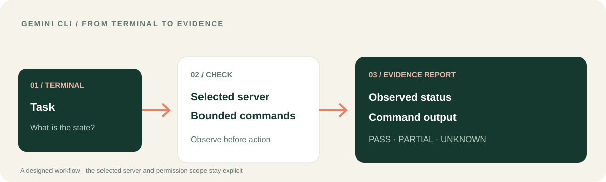

<p></p>

# LUCH for Gemini CLI
### Turn terminal work into a clear operational picture.

Gemini CLI gives you a command-line home for technical work. **LUCH can connect that workflow to a selected server, approved files and a browser session** — then help turn the observed output into a status report and a sensible next action.

[**See the Gemini CLI workflow**](docs/GEMINI_WORKFLOW.md) · [**Install the extension**](#connect-with-gemini-cli) · [Русский](README.ru.md) · [LUCH platform](https://github.com/lenar2/luch)



## A Gemini CLI workflow: from a command to an operational decision

You need to understand whether a selected service is healthy after a change.

1. Name the exact server you want to inspect.
2. Ask Gemini to check its current status through LUCH.
3. Run bounded, read-only diagnostics against that selected server.
4. Compare the observed output with the expected state.
5. Receive a short report: what was observed, what passed, what remains uncertain and what to do next.

**The value:** terminal work becomes a traceable investigation, not a pasted command whose result is hard to interpret.

[**Open the operational workflow →**](docs/GEMINI_WORKFLOW.md)

## What LUCH adds to Gemini CLI

| Your terminal task | LUCH connection |
| --- | --- |
| Inspect a service | Status and health of the exact paired server |
| Check a condition | Bounded commands with a fixed target and timeout |
| Understand a web response | A permitted isolated server-browser session, when available |
| Work with configuration or reports | Read selected files and verify changes within the granted scope |
| Coordinate a longer task | A sequence of observed steps with a result for each one |

The extension includes 12 skills. Gemini CLI remains your terminal interface; LUCH provides the connected resources actually exposed to the current account and session.

## Connect with Gemini CLI

Install the extension:

```bash
gemini extensions install https://github.com/lenar2/luch-gemini
```

Restart Gemini CLI, then check the extension and available MCP tools:

```text
/extensions list
/mcp auth luch
/mcp list
```

Start with an inspect-only task:

> Check the status of the server I selected. Do not restart it, change files or run anything outside a bounded diagnostic.

[Extension manifest](gemini-extension.json) · [Baseline instructions](GEMINI.md) · [Technical setup](https://luch.lenarsalimov.ru/docs/get-started/)

## Keep operations deliberate

The server target is explicit. Diagnostics are bounded. A restart, deployment, firewall change or other consequential operation is a separate decision, not an automatic next step.

LUCH is used for real work in the founder's connected environment. Public extension source is available to inspect; service access and account authorization are separate from installation. See [service status](https://luch.lenarsalimov.ru/en/status/) or [support](https://luch.lenarsalimov.ru/support/).

<details><summary>For developers and reviewers</summary>

- Gemini CLI extension version: v0.1.6; 12 skills.
- [`gemini-extension.json`](gemini-extension.json) declares the remote MCP endpoint.
- The [founder-environment case](https://github.com/lenar2/luch/blob/main/docs/REAL_WORK.md) demonstrates LUCH work, not a claim that Gemini CLI executed that particular case.
- Manifest parsing or package installation alone does not prove OAuth, pairing, tenant isolation or revocation. Those require separate tests.
- [Security](SECURITY.md) · [Apache-2.0](LICENSE).

</details>
