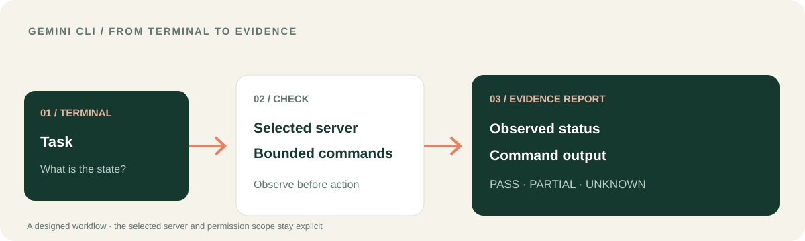

<p></p>

# LUCH для Gemini CLI
### Превратите работу в терминале в понятную картину происходящего.

Я создал расширение LUCH для Gemini CLI, чтобы работа в терминале была связана с реальными инструментами. **LUCH может соединить её с выбранным сервером, разрешёнными файлами и браузером** — а затем помочь превратить фактический вывод в отчёт о состоянии и понятный следующий шаг.

[**Сценарий Gemini CLI**](docs/GEMINI_WORKFLOW.ru.md) · [**Установить расширение**](#подключение-к-gemini-cli) · [English](README.md) · [Платформа LUCH](https://github.com/lenar2/luch)



## Сценарий Gemini CLI: от команды к решению по состоянию системы

Нужно понять, здоров ли выбранный сервис после изменения.

1. Назовите точный сервер, который требуется проверить.
2. Попросите Gemini получить через LUCH его текущий статус.
3. Выполните ограниченную диагностику без изменений на выбранном сервере.
4. Сопоставьте фактический вывод с ожидаемым состоянием.
5. Получите короткий отчёт: что наблюдалось, что прошло, что осталось неизвестным и какой следующий шаг разумен.

**Ценность:** работа в терминале превращается в проверяемое исследование, а не в команду, результат которой трудно интерпретировать.

[**Подробный сценарий эксплуатации →**](docs/GEMINI_WORKFLOW.ru.md)

## Что LUCH добавляет к Gemini CLI

| Задача в терминале | Подключение через LUCH |
| --- | --- |
| Проверить сервис | Статус и здоровье точно выбранного подключённого сервера |
| Проверить условие | Ограниченные команды с фиксированной целью и временем выполнения |
| Разобраться с веб-ответом | Разрешённая изолированная серверная сессия браузера, если доступна |
| Изучить конфигурацию или отчёт | Чтение выбранных файлов и проверка изменений в пределах разрешений |
| Провести большую задачу | Последовательность наблюдаемых этапов с результатом каждого |

В расширении 12 навыков. Gemini CLI остаётся вашей командной строкой, а LUCH предоставляет ресурсы, которые действительно доступны текущему аккаунту и сессии.

## Весь LUCH, а не только диагностика через терминал

Я создаю расширение Gemini CLI как один из входов в LUCH. Вся система включает **изолированный браузер, разрешённые локальные вкладки, файлы, подключённые компьютеры, выбранные серверы, поддерживаемые сервисы и сложные сценарии**, а также обнаружение инструментов, маршрутизацию и диагностику.

[**Полная карта возможностей LUCH →**](https://github.com/lenar2/luch/blob/main/docs/CAPABILITIES.ru.md)

В каждой сессии Gemini CLI действуют конкретные доступные инструменты и разрешения; каталог навыков не выдаёт права автоматически.

## Подключение к Gemini CLI

Установите расширение:

```bash
gemini extensions install https://github.com/lenar2/luch-gemini
```

Перезапустите Gemini CLI и проверьте расширение и доступные MCP-инструменты:

```text
/extensions list
/mcp auth luch
/mcp list
```

Начните с проверки без изменений:

> Проверь статус выбранного мной сервера. Не перезапускай его, не меняй файлы и не выполняй ничего за пределами ограниченной диагностики.

[Манифест расширения](gemini-extension.json) · [Базовые инструкции](GEMINI.md) · [Техническое подключение](https://luch.lenarsalimov.ru/docs/get-started/)

## Управление остаётся осознанным

Сервер выбирается явно. Диагностика ограничена. Перезапуск, публикация, изменение firewall и другие важные действия требуют отдельного решения, а не происходят автоматически.

Я уже использую LUCH для реальной работы в собственной подключённой среде. Исходники расширения открыты; доступ к сервису и авторизация аккаунта — отдельные шаги. [Статус сервиса](https://luch.lenarsalimov.ru/ru/status/) · [Поддержка](https://luch.lenarsalimov.ru/support/)

<details><summary>Разработчикам и проверяющим</summary>

- Версия расширения Gemini CLI: v0.1.6; 12 навыков.
- [`gemini-extension.json`](gemini-extension.json) задаёт удалённый MCP endpoint.
- [Мой документированный сценарий](https://github.com/lenar2/luch/blob/main/docs/REAL_WORK.ru.md) показывает работу LUCH, но не утверждает, что именно Gemini CLI выполнил тот сценарий.
- Проверка JSON или установка пакета сами по себе не доказывают OAuth, привязку устройства, изоляцию аккаунтов и отзыв доступа. Для этого нужны отдельные тесты.
- [Безопасность](SECURITY.md) · [Apache-2.0](LICENSE).

</details>
